# Student Management Database

A student management database built with **MongoDB (Mongoose)**, with a **Node.js/Express** REST API for CRUD operations and an automated test script.

- Two collections: `students` and `courses`, linked by a reference (one course : many students)
- Student fields: student ID, name, email, course, contact details (phone, address)
- Validation, unique constraints and referential-integrity checks keep data accurate
- Full schema description: see [SCHEMA.md](SCHEMA.md)

## Project Structure

```
├── models/
│   ├── Course.js        # courses schema
│   └── Student.js       # students schema (references Course)
├── routes/
│   ├── courses.js       # course CRUD
│   └── students.js      # student CRUD
├── test/crud.test.js    # tests all database operations
├── app.js               # Express app + error handling
├── server.js            # DB connection + server start
├── SCHEMA.md            # database schema
└── screenshots/
```

## Setup

Requires Node.js 18+ and MongoDB running locally.

```bash
npm install
cp .env.example .env      # Windows: copy .env.example .env
npm start
```

The server runs at http://localhost:5000 and creates the `student_management` database on first insert.

## API

| Method | Endpoint | Description |
|--------|----------|-------------|
| POST / GET | `/api/courses` | Create / list courses |
| GET / PUT / DELETE | `/api/courses/:id` | Read / update / delete a course |
| POST / GET | `/api/students` | Create / list students (`?course=<id>` filters) |
| GET / PUT / DELETE | `/api/students/:id` | Read / update / delete a student |

Create a course first, then use its `_id` when creating students:

```json
POST /api/courses
{ "code": "CS101", "name": "Computer Science", "durationMonths": 36 }

POST /api/students
{
  "studentId": "STU001",
  "name": "Priya Sharma",
  "email": "priya@example.com",
  "course": "<course _id>",
  "contact": { "phone": "9876543210", "address": "Hyderabad" }
}
```

Errors return `{ "message": "..." }` with status 400 (validation / bad ID), 404 (not found) or 409 (duplicate, or course still has students).

## Testing

```bash
npm test
```

Runs 17 checks (create, read, update, delete, duplicate email/ID, invalid email/phone, missing fields, non-existent course, course-delete protection) against a separate `student_management_test` database, so real data is never touched.

## Viewing the data

Open MongoDB Compass at `mongodb://127.0.0.1:27017` and browse `student_management`, or use mongosh:

```
use student_management
db.students.find().pretty()
db.courses.find().pretty()
```

## Screenshots

### Tests
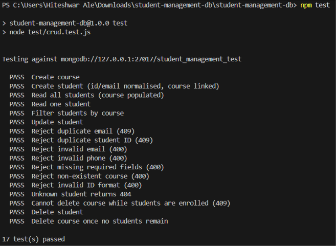

### Create (courses and students)

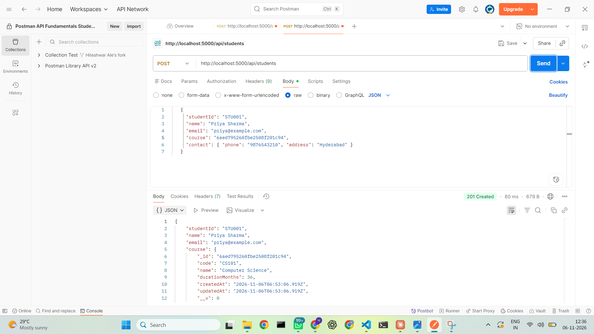
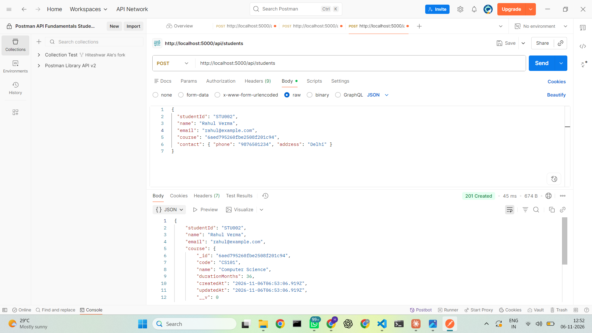

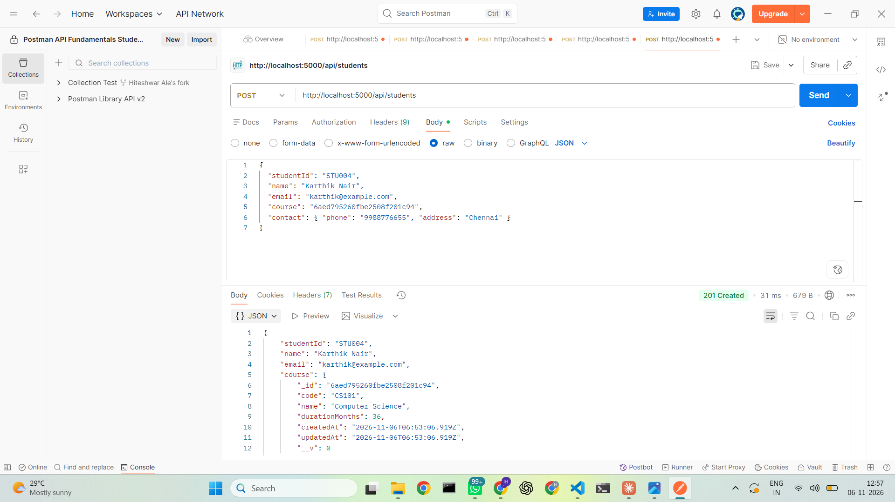
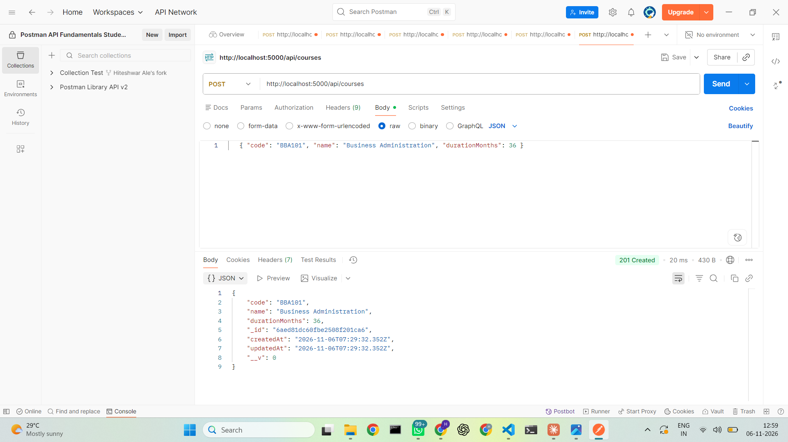

### Read
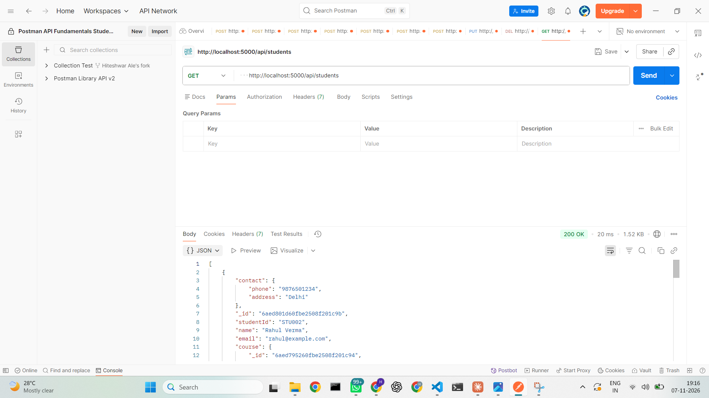

### Update
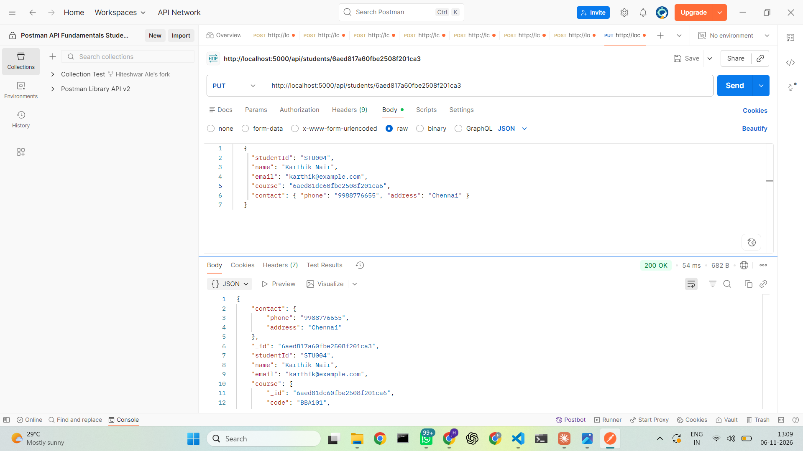

### Delete
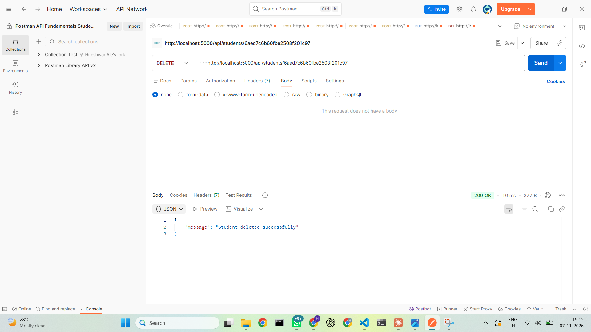

### Validation and relationships
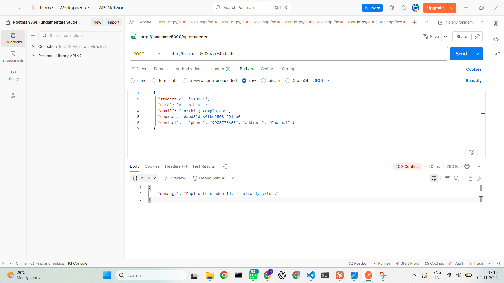
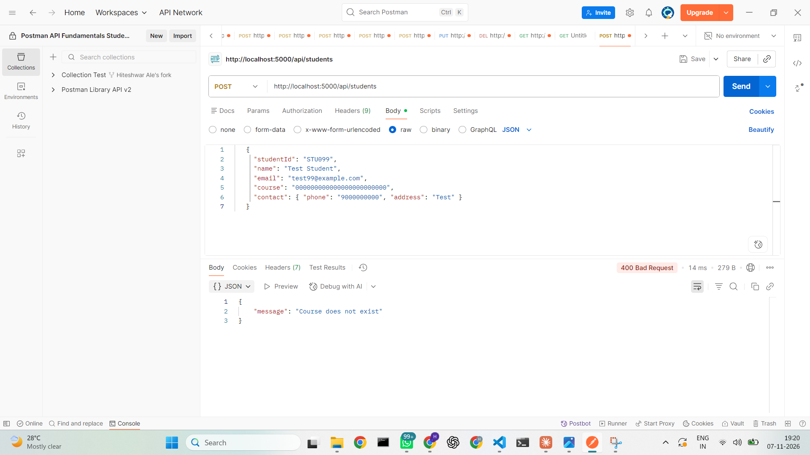
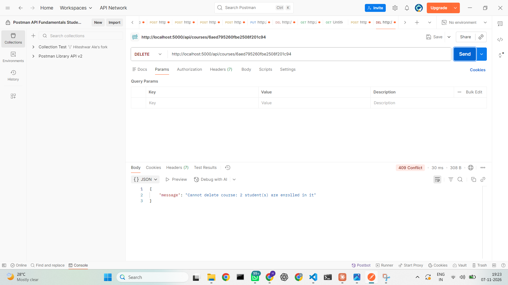

### Database (MongoDB Compass)
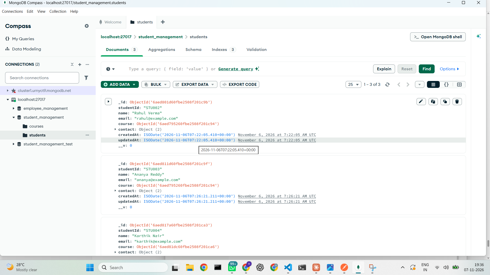
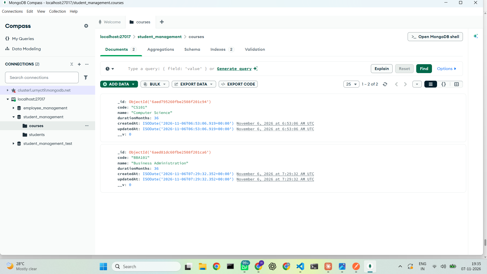
